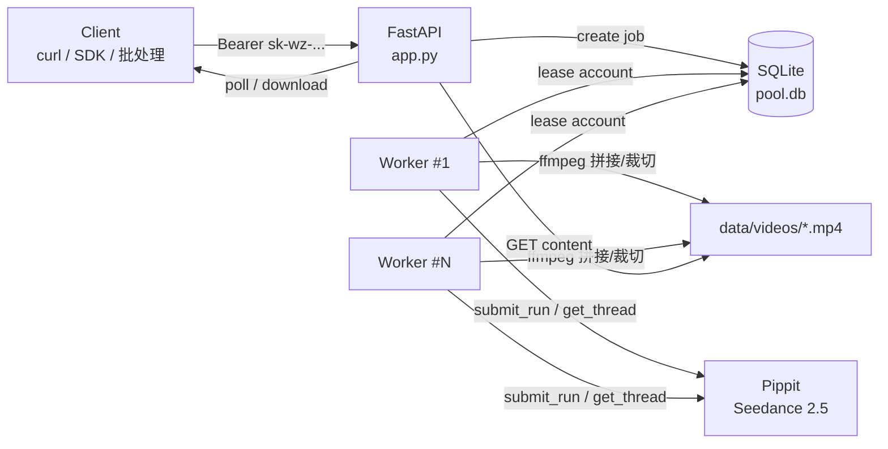

# Pippit 账号池 + Seedance 2.5 视频网关

> 一个 OpenAI 风格的 HTTP 视频生成接口，背后是一整池 Pippit 账号。
> 客户端只认一个 `Bearer sk-wz-...`，选号、排队、重试、拼接、落盘、清理全部由服务端负责。

[](https://www.python.org/)
[](https://fastapi.tiangolo.com/)
[](https://sqlite.org/)
[](#license)

**English**: An OpenAI-compatible video generation gateway backed by a pool of Pippit accounts running Dreamina **Seedance 2.5**. One API key drives the whole pool: account selection, queueing, retries, segment stitching, storage and cleanup are handled server-side.

---

## 目录

- [为什么需要它](#为什么需要它)
- [特性](#特性)
- [架构](#架构)
- [快速开始](#快速开始)
- [配置项](#配置项)
- [API 参考](#api-参考)
- [时长语义：单段 vs 拼接](#时长语义单段-vs-拼接)
- [队列与可靠性](#队列与可靠性)
- [号池运维](#号池运维)
- [目录结构](#目录结构)
- [本地工具](#本地工具)
- [实测数据](#实测数据)
- [常见问题](#常见问题)
- [安全声明](#安全声明)
- [Roadmap](#roadmap)
- [License](#license)

---

## 为什么需要它

Pippit 的单账号有积分上限、有平台侧限速，单个账号跑不出稳定产能；而每个账号的登录态（cookies）、workspace、space 又各不相同。

这个项目把「一堆账号」抽象成「一个 OpenAI 风格 API」：

- 上游几十个并发客户端 → 下游自动摊到几百个账号上；
- 单个账号被限速或掉登录 → 自动换号重试，客户端无感；
- 客户端只关心 `POST /v1/videos` 和 `GET /v1/videos/{id}`，不需要知道池子里有几个号。

## 特性

| 能力 | 说明 |
|---|---|
| OpenAI 风格端点 | `POST /v1/videos`、`POST /v1/video/generations`（别名）、`GET /v1/videos/{id}`、`GET /v1/videos/{id}/content` |
| 异步任务模型 | 立即返回 `queued`，轮询状态：`queued / in_progress / completed / failed / canceled` |
| 自动选号 | 按「积分够不够 + 冷却时间 + 最近使用」挑账号，失败自动换号 |
| 单段 / 多段两条车道 | `<= 17s` 单段直出；更长自动分段 + 交叉淡化拼接 |
| 积分核算 | 每条约 4 积分/秒（实测），额度不足时返回 503 并给出池内最大余额 |
| 任务落盘 | 视频按 `data/videos/<job_id>.mp4` 保存，支持 Range 下载与 `HEAD` 探测 |
| 管理面 | API Key 增删查、账号导入/刷新、任务列表/清理、总台面板 `/master` |
| 看门狗 | 心跳事件 + 僵尸任务回收 + 账号冷却，避免「重复提交、重复扣分」 |
| 单文件部署 | FastAPI + SQLite，无外部依赖；systemd 一条命令起服务 |

## 架构



- **API 进程**：鉴权、建单、查单、下载，同步接口跑在 FastAPI 线程池里。
- **Worker 池**：`WZ_MAX_WORKERS` 个线程，从 `jobs` 表抢单（`status='queued'`），抢到即 `running`。
- **账号租约**：每个 worker 用文件锁（`data/locks/<uid>.lock`）独占一个账号，结束后回写积分并释放。
- **看门狗**：每 180s 扫一次 `running` 任务，`MAX(events.ts)` 超过 `WZ_STALE_SECS` 没有心跳就判定 worker 已死，重排或置失败。

## 快速开始

```bash
# 1) 依赖
python3.12 -m venv venv && . venv/bin/activate
pip install -r server/requirements.txt      # fastapi uvicorn requests paramiko

# 2) 起服务
export WZ_PORT=8788
export WZ_HOST=0.0.0.0
export WZ_MAX_WORKERS=32
export WZ_AUTO_CLAIM=1
python -u server/app.py
```

systemd：

```ini
[Unit]
Description=Pippit Pool OpenAI-compatible Video API
After=network.target

[Service]
Type=simple
WorkingDirectory=/opt/pippit-pool
Environment=WZ_PORT=8788
Environment=WZ_HOST=0.0.0.0
Environment=WZ_MAX_WORKERS=32
Environment=WZ_AUTO_CLAIM=1
Environment=PYTHONUNBUFFERED=1
ExecStart=/opt/pippit-pool/venv/bin/python -u app.py
Restart=always
RestartSec=3
LimitNOFILE=65535
StandardOutput=append:/var/log/pippit-pool.log
StandardError=append:/var/log/pippit-pool.log

[Install]
WantedBy=multi-user.target
```

首次启动会生成管理令牌：

```bash
cat data/admin_token.txt        # 管理接口用 X-Admin-Token
```

创建第一把 Key：

```bash
ADMIN=$(cat data/admin_token.txt)
curl -s -X POST http://127.0.0.1:8788/admin/keys \
  -H "X-Admin-Token: $ADMIN" -H 'Content-Type: application/json' \
  -d '{"name":"my-app","quota":0}'
# -> {"id":"key_...","key":"sk-wz-..."}
```

## 配置项

| 环境变量 | 默认 | 说明 |
|---|---|---|
| `WZ_HOST` / `WZ_PORT` | `0.0.0.0` / `8788` | 监听地址 |
| `WZ_MAX_WORKERS` | `2` | Worker 线程数（= 池内最大并发任务数） |
| `WZ_PER_KEY_CONCURRENCY` | `2` | 单个 Key 允许的在飞任务数 |
| `WZ_MAX_SECONDS` | `30` | 单条任务时长上限 |
| `WZ_AUTO_CLAIM` | `0` | 账号积分低于 120 时自动领取每日积分 |
| `WZ_STALE_SECS` | `900` | 心跳超过该秒数判定 worker 死亡 |
| `WZ_XFADE` | `0` | 分段拼接交叉淡化秒数（0 = 直接拼） |
| `WZ_25_MULTI` / `WZ_20_MULTI` | `1` | 是否允许 2.5 / 2.0 走多段拼接 |
| `WZ_ADMIN_TOKEN` | 随机 | 覆盖 `data/admin_token.txt` |

## API 参考

完整字段说明见 [`docs/API.md`](docs/API.md)。

### 认证

```
Authorization: Bearer sk-wz-...
```

### 模型

| model | 分辨率 | 默认时长 | 语义 |
|---|---|---|---|
| `seedance-2.5-720p-natural` | 720p | 15s（上限 17s） | **单段直出，不拼接**，输出 15~22s |
| `seedance-2.5-1080p-natural` | 1080p | 15s（上限 17s） | 同上 |
| `seedance-2.5-natural` | 720p | 15s | 上者别名 |
| `seedance-2.5-720p-30s` | 720p | 30s | 多段拼接（2 段） |
| `seedance-2.5-1080p-30s` | 1080p | 30s | 多段拼接 |
| `seedance-2.5` | 1080p | 30s | 等价 1080p-30s |
| `seedance-2.0-*` | 720p/1080p | 30s | 2.0 车道（fast / mini / mini-lite） |

### 建单

```bash
curl -s -X POST http://127.0.0.1:8788/v1/videos \
  -H "Authorization: Bearer $KEY" -H 'Content-Type: application/json' \
  -d '{
        "model": "seedance-2.5-720p-natural",
        "prompt": "a rainy neon street at midnight, slow dolly, cinematic",
        "seconds": 15,
        "ratio": "9:16"
      }'
```

```json
{
  "id": "video_f199d1657d6b448506df273d",
  "object": "video",
  "status": "queued",
  "model": "seedance-2.5-720p-natural",
  "seconds": 15,
  "size": "720x1280",
  "progress": 0
}
```

参数：`model` `prompt` `seconds`/`duration` `resolution` `size` `ratio` `n`(=1) `reference_image_url` `reference_video_url` `reference_audio_url`（音频必须配图或视频）。

### 查询 / 下载 / 取消

```bash
curl -s -H "Authorization: Bearer $KEY" http://127.0.0.1:8788/v1/videos/$JOB
curl -s -H "Authorization: Bearer $KEY" -o out.mp4 http://127.0.0.1:8788/v1/videos/$JOB/content
curl -s -X POST -H "Authorization: Bearer $KEY" http://127.0.0.1:8788/v1/videos/$JOB/cancel
```

完成后的任务对象追加：

```json
{
  "status": "completed",
  "progress": 100,
  "output_url": "http://host/v1/videos/<id>/content",
  "width": 1080, "height": 1920,
  "duration": 15.0,
  "bytes": 30320026,
  "asset_id": "204382385926"
}
```

### 管理接口

| 方法 | 路径 | 说明 |
|---|---|---|
| `POST` | `/admin/keys` | 建 Key（`name` / `quota` / `expires_in_days`） |
| `GET` | `/admin/keys` | Key 列表（不含明文） |
| `DELETE` | `/admin/keys/{id}` | 作废 Key |
| `POST` | `/admin/accounts/import` | 导入账号（cookies / workspace / space） |
| `GET` | `/admin/accounts` | 账号列表与余量 |
| `POST` | `/admin/accounts/refresh` | 刷新积分 |
| `GET` | `/admin/jobs` | 全部任务 |
| `POST` | `/admin/jobs/{id}/purge` | 删任务与文件 |
| `GET` | `/healthz` | 健康检查 |

## 时长语义：单段 vs 拼接

这是本项目最容易踩的坑，先说结论：

> **请求时长 ≠ 产出时长。** 平台侧单次生成的时长由模型自己决定，实测落在 **15~22s**。

规则（`worker.py`）：

```python
multi = secs > seg_cap + 2      # 2.5: seg_cap = 15  ->  >17s 才拼接
```

- `seconds <= 17` → **单段**：一次 `submit_run`，出多少给多少，不做裁切。耗时通常 4~10 分钟。
- `seconds > 17` → **多段**：按 15s/段切片，逐段生成后交叉淡化拼接，最后裁到目标时长。耗时 10~35 分钟。

规划阶段拿不到可信时长：`generate_video_idea` 的 `duration_sec` 实测恒为 `8.0` 占位值（连续 5 次），强制渲染得到 20.016s，偏差 2.5 倍 —— **不要用它做预筛**。

但有个好消息：**渲染开始前 `cancel_run` 不扣积分**（实测 5 次，余额 90→90、128→128）。一旦开始渲染，积分立刻锁死。

## 队列与可靠性

| 机制 | 参数 | 作用 |
|---|---|---|
| 心跳 | 150s | 长轮询期间写 `hb` 事件，避免被误判为僵尸 |
| 僵尸回收 | `WZ_STALE_SECS=900` | 无心跳的 `running` 任务重排；超过 `max_attempts` 置失败 |
| 单段超时 | 1200s | 卡死就换号重试，而不是无限等 |
| 换号 | 自动 | 提交/轮询异常时释放当前账号（冷却 600s）并换下一个 |
| 分段重试 | 2 次 | 每段最多两次尝试，控制最坏耗时 |
| 积分门槛 | 60 | 多段途中余额低于 60 直接收尾，避免半成品 |

上线前后的对照（同一台机器、同一批 30s 任务）：

| 指标 | 修复前 | 修复后 |
|---|---|---|
| 看门狗误重排 | 14 次 / 30 min | **0 次 / 25 min** |
| 单条 30s 平均耗时 | 19.6 min | 11~17 min |
| 状态抖动（queued ↔ in_progress） | 频繁 | 基本消失 |

## 号池运维

```bash
# 导入账号（cookies 必须带 domain=".pippit.ai"，否则上游返回 1015）
curl -s -X POST http://127.0.0.1:8788/admin/accounts/import \
  -H "X-Admin-Token: $ADMIN" -H 'Content-Type: application/json' \
  -d '{"accounts":[{"uid":"...","tag":"farm1","cookies":[...],"workspace_id":"...","space_id":"..."}]}'

# 刷新积分
curl -s -X POST http://127.0.0.1:8788/admin/accounts/refresh -H "X-Admin-Token: $ADMIN"
```

约定：

- `status`：`ready`（可接单）/ `busy`（被租用）；冷却由 `cooldown_until` 控制。
- `credit`：账号剩余积分；`WZ_AUTO_CLAIM=1` 时低于 120 会自动领每日积分。
- 账号文件锁在 `data/locks/<uid>.lock`，进程重启时视为过期并清理。

## 目录结构

```
.
├── server/
│   ├── app.py              # FastAPI：路由、鉴权、建单/查单/下载、管理面
│   ├── worker.py           # Worker 池：抢单、选号、分段、拼接、看门狗
│   ├── pippit.py           # Pippit 协议客户端：submit_run / get_thread / asset / download
│   ├── db.py               # SQLite 访问层：jobs / accounts / api_keys / events
│   ├── refs.py             # 参考图 / 视频 / 音频上传
│   ├── _pp_http.py         # HTTP 层：签名、cookie、重试
│   ├── panel.py            # /master 总台面板后端
│   ├── panel.html          # /master 前端
│   ├── requirements.txt
│   └── openapi.json        # 静态 OpenAPI 快照
├── clients/
│   └── openai_client.py    # 最小可用客户端（create / poll / download）
├── examples/
│   ├── curl.sh
│   └── python_sdk_style.py
├── docs/
│   ├── API.md              # 全量接口文档
│   ├── PROTOCOL.md         # 上游协议笔记（submit_run / get_thread / 资产 / 计费）
│   └── SERVER-README.zh.md # 服务端原始中文说明
└── README.md
```

## 本地工具

| 脚本 | 用途 |
|---|---|
| `clients/openai_client.py` | `BASE`/`KEY` 两个环境变量即可建单、轮询、下载 |
| `examples/curl.sh` | 纯 curl 的最小闭环 |
| `examples/python_sdk_style.py` | 模仿 `openai` SDK 的封装写法 |

上游协议细节（签名头、`submit_run` 请求体、`get_thread` 的 `scopes`、资产 URL、积分扣减时机）见 [`docs/PROTOCOL.md`](docs/PROTOCOL.md)。

## 实测数据

15s 单段、9:16、2.5 车道，全部 `ffprobe` 实测：

| job | 分辨率 | 排队 | 渲染 | 成片 | 字节 |
|---|---|---|---|---|---|
| `video_f199d1…` | 720p | 30.0 min | 7.2 min | 15.000000s / 1080x1920 | 30,320,026 |
| `video_f9f917…` | 1080p | 9.2 min | 4.5 min | 15.000000s / 1080x1920 | 30,492,147 |

请求时长与产出的关系（单段车道）：

| 请求 | 实得 | 帧 | 计费 |
|---|---|---|---|
| 10s | 14.917s | 448 | 59 |
| 15s | 15.000s | 450 | 60 |
| 15s | 20.016s | 600 | 80 |
| 30s | 15.983s | 480 | 63 |
| 30s | 22.036s | 661 | 88 |
| 30s | 20.016s | 600 | 80 |

- 区间 **14.917 ~ 22.036s**，均值 **17.995s**；
- 计费恒为 **实际秒数 × 3.94~4.00**。

## 常见问题

**Q：为什么 `seconds: 30` 只给我 15 秒？**
A：单段车道下平台自己决定时长。要 30 秒请用 `-30s` 模型走拼接，代价是 10~35 分钟。

**Q：任务一直 `in_progress 40%`？**
A：40% = 已提交、平台侧生成中。日志里每 150s 一条 `hb` 事件即为正常；超过 20 分钟无进展会自动换号重试。

**Q：为什么导进去的账号全部 `ret=1015`？**
A：cookies 缺 `domain`。补成 `domain=".pippit.ai"` 再导入。

**Q：能同时跑多少条？**
A：上限 = `WZ_MAX_WORKERS`。单 Key 并发由 `WZ_PER_KEY_CONCURRENCY` 限制，超了返回 429。

## 安全声明

- 本仓库**不包含**任何账号、cookie、API Key、管理令牌或生产环境地址；敏感值一律通过环境变量或 `data/` 注入，`data/` 已在 `.gitignore` 中。
- 项目用于**自有账号 / 已获授权环境**的批量视频生产与协议研究。使用者需自行确认对账号、内容与上游服务条款的合规性，作者不对滥用负责。
- 上游是第三方服务，接口随时可能变更；本项目通过 `docs/PROTOCOL.md` 记录观测到的协议行为，不保证长期兼容。

## Roadmap

- [ ] 队列公平性：自然时长单优先于 30s 拼接单
- [ ] 任务级截止时间（超过 N 分钟直接失败，释放 worker）
- [ ] 多上游（同一接口后可挂 Pippit / 其他视频后端）
- [ ] Prometheus 指标：队列深度、单条耗时分布、账号可用率
- [ ] Webhook 回调，省掉客户端轮询

## License

MIT